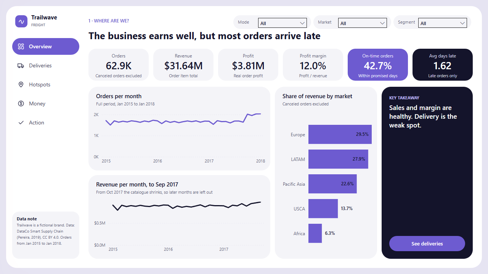
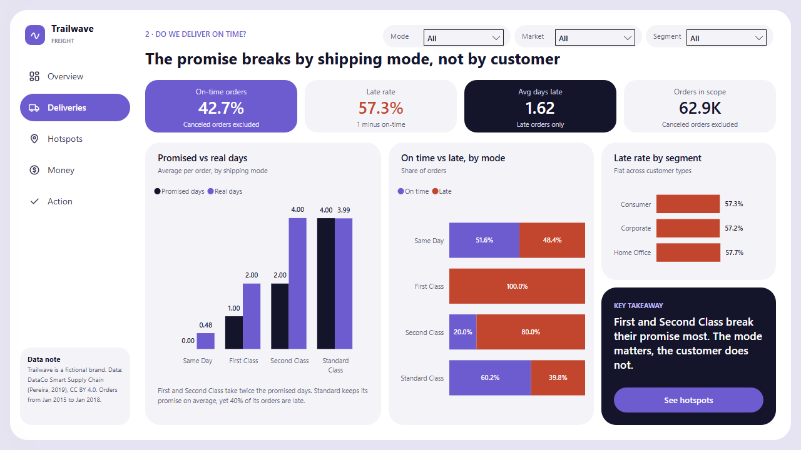
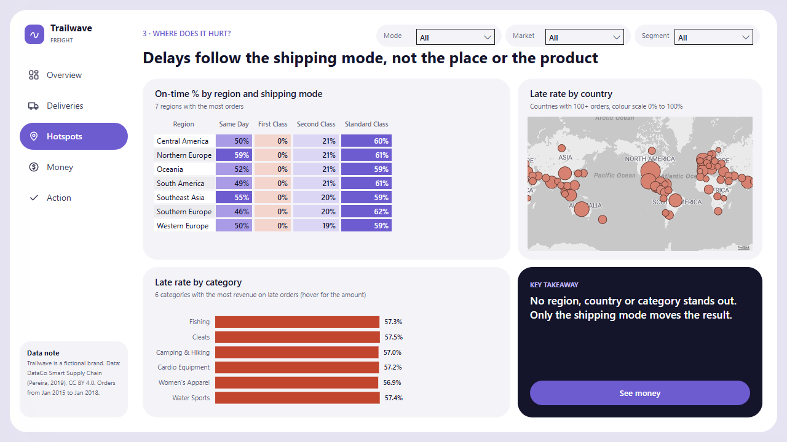
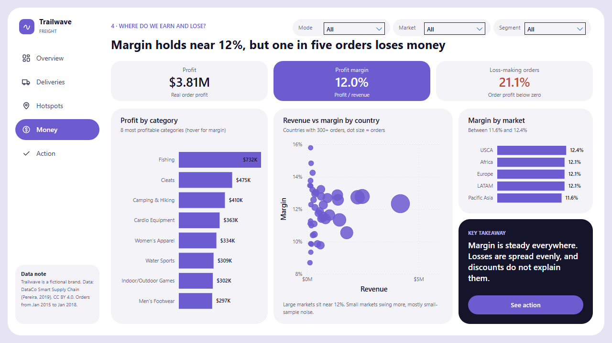
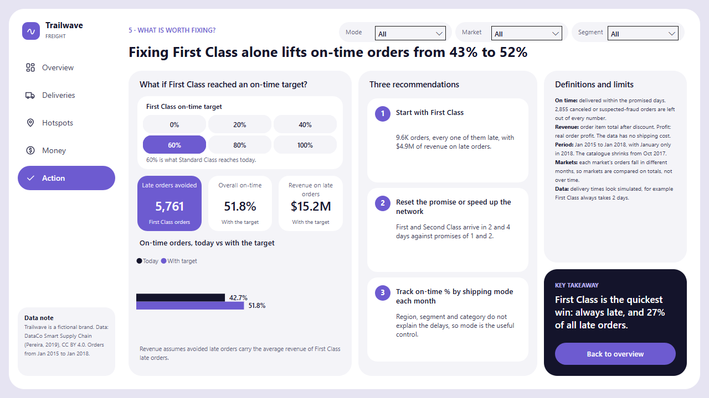
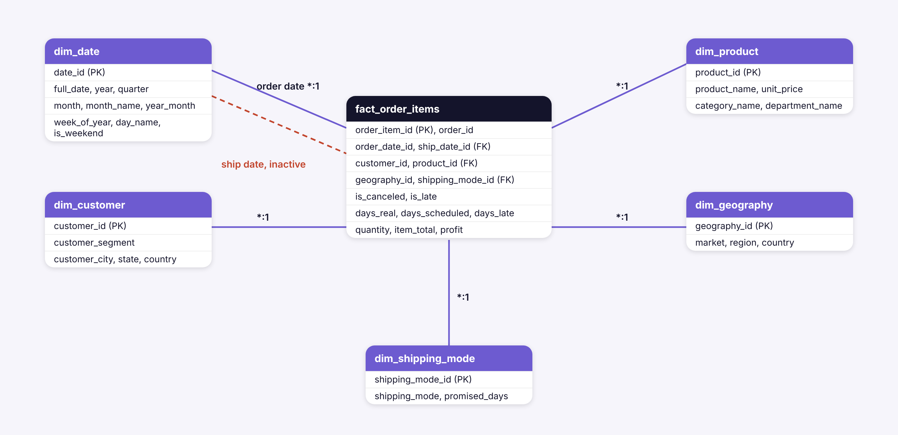

<p align="center">
  
</p>

# Trailwave Freight | Supply Chain Delivery Report

A Power BI report for Trailwave Freight, a fictional logistics company. It uses the DataCo Smart Supply Chain dataset (180,519 order items, January 2015 to January 2018) to answer one question: where does the business win, and where does it lose?

The data is loaded into PostgreSQL with a Python notebook, checked with SQL, and modelled as a star schema in Power BI.



## Business question

An operations manager wants to know, in under a minute:

- Is the business healthy?
- Do orders arrive when we promise they will?
- Is the problem a place, a customer type or a product, or something else?
- Do we make money everywhere?
- What is the first thing worth fixing?

## Key findings

All numbers leave out canceled and suspected-fraud orders (2,855 of 65,752 orders).

- **The business earns well.** 62.9K orders, $31.64M in revenue, $3.81M in profit and a 12.0% margin.
- **Most orders arrive late.** Only 42.7% arrive within the promised days. Late orders are 1.62 days late on average.
- **The shipping mode explains the delays.** First Class is late on 100% of orders, Second Class on 80%, Same Day on 48.4% and Standard Class on 39.8%.
- **The promise itself is wrong for the faster modes.** First Class promises 1 day and takes 2. Second Class promises 2 days and takes 4. Standard Class promises 4 days and takes 3.99.
- **Customers, regions and categories do not explain the delays.** The late rate is 57.2% to 57.7% across the three customer segments, and the same pattern repeats in every region.
- **Margin is steady, but one order in five loses money.** Margin is between 11.6% and 12.4% in every market, and 21.1% of orders have a profit below zero.
- **First Class is the quickest win.** It is 27% of all late orders. If First Class reached the on-time rate that Standard Class has today (60%), 5,761 late orders would be avoided and the overall on-time rate would go from 42.7% to 51.8%.

## Report structure

The report has five pages (1280 x 720). The Mode, Market and Segment filters in the header apply to every page, and each page ends with a key takeaway and a button to the next page.

### 1. Overview

Six headline numbers, orders per month, revenue per month and revenue share by market. Revenue is shown only until September 2017, because the product catalogue shrinks from October 2017 and later months are not comparable.

### 2. Deliveries



Promised against real days by shipping mode, on-time against late by mode, and the late rate by customer segment.

### 3. Hotspots



A matrix of on-time % by region and shipping mode (the 7 regions with the most orders), a map of the late rate by country (countries with 100 or more orders) and the late rate for the 6 categories with the most revenue on late orders. The map uses the Azure Maps visual.

### 4. Money



Profit, margin and the share of loss-making orders, profit for the 8 most profitable categories, revenue against margin by country (300 or more orders) and margin by market.

### 5. Action



A what-if for First Class. Pick an on-time target from 0% to 100%, and the page shows the late orders avoided, the new overall on-time rate and the revenue still sitting on late orders. It opens at 60%, the level Standard Class reaches today. The page also lists three recommendations and the definitions and limits of the data.

## Data model



The model is a star schema. All relationships are one-to-many from the fact table to a dimension, with single-direction filtering.

| Table | Type | Rows | Description |
|---|---|---|---|
| `fact_order_items` | Fact | 180,519 | One row per order item, with delivery fields, quantity, revenue and profit |
| `dim_date` | Dimension | 1,461 | One row per day. The order date relationship is active and the ship date relationship is inactive |
| `dim_product` | Dimension | 118 | Product, category and department |
| `dim_customer` | Dimension | 20,652 | Customer segment and location |
| `dim_geography` | Dimension | 167 | Market, region and country |
| `dim_shipping_mode` | Dimension | 4 | Shipping mode and promised days |
| `First Class Target` | Disconnected | 6 | Drives the target selector on the Action page |
| `_Measures` | Measures | | All measures, grouped in display folders |

## Data preparation

The Python notebook (`python/01_etl_pipeline.ipynb`) reads the raw CSV, builds the tables above and loads them into PostgreSQL. The main decisions:

- Customer names, emails, passwords and street addresses are not loaded. The report does not need them.
- Country names are translated from Spanish to English.
- Delivery fields repeat on every item of an order, so delivery measures count distinct orders, not rows.
- An order counts as canceled when its shipping was canceled or it is flagged as suspected fraud. These orders are excluded from every measure and every query.
- The notebook checks its own output (row counts, keys, totals against the source) before it finishes.

## SQL

| File | What it does |
|---|---|
| `01_create_schema.sql` | Creates the star schema. Safe to re-run |
| `02_validation_checks.sql` | Data quality checks. Each query returns the rows that break a rule, so an empty result means it passed |
| `03_business_questions.sql` | Fourteen business questions, from headline KPIs to the First Class analysis |
| `04_measure_checks.sql` | The same numbers as the report measures, to check the DAX against SQL |

## DAX highlights

The report has 40 measures (see `powerbi/measures.dax`).

**Delivery measures work at order level.** Because delivery fields repeat on every item, the average days late takes one value per order first.

```dax
Avg Days Late =
CALCULATE (
    AVERAGEX (
        VALUES ( fact_order_items[order_id] ),
        CALCULATE ( MAX ( fact_order_items[days_late] ) )
    ),
    fact_order_items[is_late] = TRUE (),
    fact_order_items[is_canceled] = FALSE ()
)
```

**What-if for First Class.** The selected target is multiplied by the number of First Class orders. The difference with today's on-time orders is the number of late orders avoided.

```dax
Late Orders Avoided =
VAR TargetOnTime = [First Class Orders] * [First Class Target Value]
VAR OnTimeToday = [First Class On-Time Orders]
RETURN
    MAX ( 0, ROUND ( TargetOnTime - OnTimeToday, 0 ) )
```

**Top-N in DAX.** Visuals that show only the top items use a small measure, so the rule is visible in the model and not hidden in a visual's settings.

```dax
Profit (Top 8 Categories) =
IF (
    NOT ISBLANK ( [Profit] )
        && RANKX ( ALLSELECTED ( dim_product[category_name] ), [Profit], , DESC ) <= 8,
    [Profit]
)
```

Other techniques: colours returned by measures (the matrix and the map), a selection label that describes the active filters, and a fixed colour scale so that a flat result looks flat.

## Design

The page backgrounds contain only shapes: the white sheet, the sidebar, the cards and the filter pills. All text and numbers are Power BI visuals. Colours: purple `#6D5BD0` for the brand, near-black `#14142B` for emphasis and rust `#C2452D` for late orders. The theme is stored in the report.

## How to open the report

1. Install [Power BI Desktop](https://www.microsoft.com/power-bi/desktop) (free).
2. Download this repository and open `powerbi/trailwave_supply_chain.pbix`.

The data is imported into the file, so you do not need the CSV or a database to open it. If the map does not load, check that map visuals are enabled in *File > Options and settings > Options > Security*.

## How to reproduce the data

1. Install PostgreSQL and create a database called `trailwave`.
2. Download the dataset (see `data/README.md`) and place `DataCoSupplyChainDataset.csv` in the `data/` folder.
3. Install the packages: `pip install -r requirements.txt`.
4. Copy `.env.example` to `.env` and fill in your connection details.
5. Run `python/01_etl_pipeline.ipynb` from top to bottom. It creates the schema by running `sql/01_create_schema.sql`, so you do not need to run that file yourself.
6. Run `sql/02_validation_checks.sql`, `sql/03_business_questions.sql` and `sql/04_measure_checks.sql` in your SQL client.

## Repository structure

```
powerbi/
  trailwave_supply_chain.pbix   Power BI report
  measures.dax                  All measures, for reading on GitHub
python/
  01_etl_pipeline.ipynb         Load the CSV into PostgreSQL
sql/
  01_create_schema.sql          Star schema
  02_validation_checks.sql      Data quality checks
  03_business_questions.sql     Business questions
  04_measure_checks.sql         Checks of the report numbers
data/
  README.md                     Where to download the dataset
images/                         Logo and screenshots used in this README
.env.example                    Template for the database connection
requirements.txt
LICENSE
README.md
```

## About the data

Trailwave Freight is a fictional brand. The data comes from the DataCo Smart Supply Chain dataset (Pereira, 2019), published under CC BY 4.0 on [Mendeley Data](https://data.mendeley.com/datasets/8gx2fvg2k6/5). Three things to know when reading the report:

- The dataset has no shipping cost, so profit is the profit of the order itself.
- Each market has orders only in certain periods, so markets are compared on totals and not over time.
- The delivery times look simulated. For example, First Class always takes 2 days.

## Author

**João Felicíssimo**
Data Analyst | Power BI | SQL | Python
[LinkedIn](https://www.linkedin.com/in/joaofelicissimo07/) · [GitHub](https://github.com/JoaoFelicissimo03)

## License

Released under the [MIT License](LICENSE).
